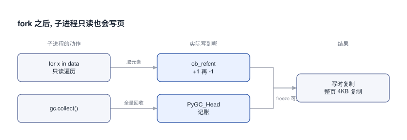

# fork之后子进程只读也会复制内存

父进程备好 100 万个对象再 fork, 子进程只把它们遍历一遍, 一个字段没改. 子进程自己的脏页多了 61.3 MB.

## 0x00 读也会写



fork 之后父子共用物理页, 谁先写某一页, 内核才给谁复制一份. 上图左列是子进程以为的只读动作, 中列是它们真正写到的地方. 遍历每取一个元素, `ob_refcnt` 先加一再减一. 全量 gc 要在 `PyGC_Head` 里记账. 两条都会让整页被复制.

## 0x01 实测六种情况

| 子进程做了什么 | 对象 | 子进程新增脏页 |
|---|---|---|
| 什么也不做 | float | 0.1 MB |
| 遍历一遍 | float | 30.7 MB |
| 遍历一遍 | list | 61.3 MB |
| gc.collect() | list | 62.0 MB |

表里看最后一列. 光是遍历, 100 万个 float 就弄脏 30.7 MB. 小列表更大, 头前还有一块 PyGC_Head, 到 61.3 MB.

## 0x02 freeze 只挡 gc

```text [fork-cow-freeze]
list  gc          freeze  child_dirty=     0.1 MB
list  iterate+gc  freeze  child_dirty=    61.3 MB
```

Python 文档的办法是父进程早点 `gc.disable()`, fork 前 `gc.freeze()`, 子进程再 `gc.enable()`. freeze 之后 gc 那一笔压到 0.1 MB. 可子进程只要再遍历一遍, 又回到 61.3 MB, 因为引用计数照改.

数字来自同目录 [fork_cow.py](fork_cow.py), 原始输出在 [measure.txt](measure.txt). 环境是 Linux 6.12 aarch64 加 Python 3.12.15, 连跑两次相同.
