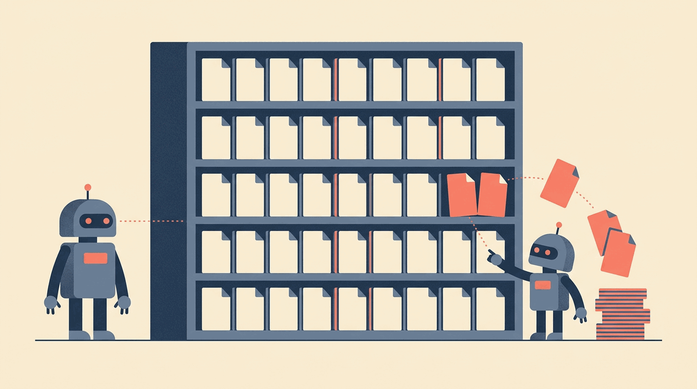
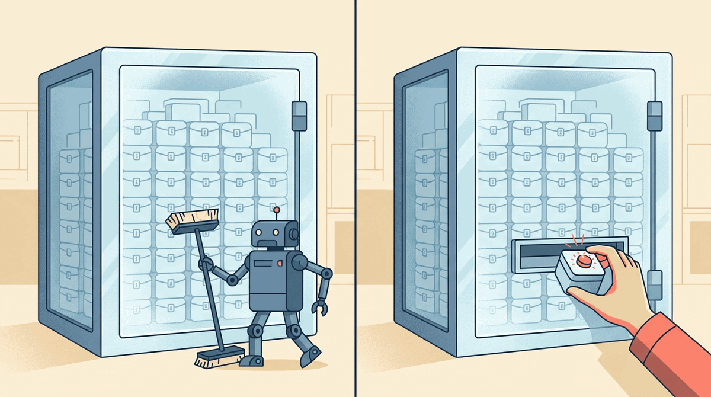
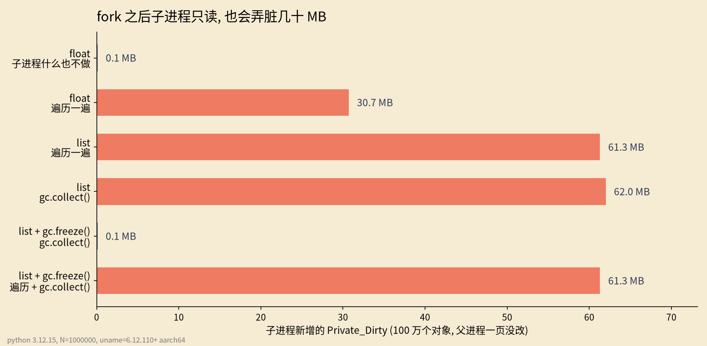

# fork之后子进程只读也会复制内存

父进程备好 100 万个对象再 fork, 子进程只把它们遍历一遍, 一个字段没改. 子进程自己的脏页多了 61.3 MB.

## 0x00 只是看了一眼



fork 之后父子共用同一批物理页, 谁先写某一页, 内核才给谁复制一份. 这叫写时复制. 上图里子进程只是伸手去读, 可它手里的那页还是被复制走了. 问题出在 CPython 的"读"本身就会写.

## 0x01 读一个对象, 会改它头上的计数


每个 CPython 对象开头都有一个引用计数 `ob_refcnt`. `for x in data` 每取一个元素, 计数先加一再减一. 这一笔写落在对象所在的页上, 所以图里拿起的那个盒子, 计数器一跳, 底下的页就亮了.

```python [fork-cow-遍历]
def child(data, action: str, w: int) -> None:
    before = private_dirty_kb()  # 读 /proc/self/smaps_rollup 的 Private_Dirty
    if action == "iterate":
        for x in data:  # 只读: 取出来, 不改
            pass
    ...
```

100 万个 float 遍历一遍, 子进程多出 30.7 MB 脏页. 换成 100 万个 `[i]` 小列表是 61.3 MB. 列表对象更大, 头前还多一块 PyGC_Head, 同样个数铺开的页更多.

## 0x02 gc 也会写, freeze 只挡得住它



不遍历, 只在子进程里调一次 `gc.collect()`, 也是 62.0 MB. 归 gc 管的对象头前还有一块 `PyGC_Head`, 全量回收要在里面记账, 一样写页.

Python 文档给的办法是父进程早点 `gc.disable()`, fork 前 `gc.freeze()`, 子进程再 `gc.enable()`. freeze 把现存对象挪进永久代, 之后的回收不再碰它们, 左半张图就是这个. 右半张图是它挡不住的部分: 读对象照样改引用计数.

## 0x03 实测: freeze 挡掉 gc, 挡不掉遍历



| 子进程做了什么 | 没有 freeze | 先 gc.freeze() |
|---|---|---|
| gc.collect() | 62.0 MB | 0.1 MB |
| 遍历一遍再 gc.collect() | (没测) | 61.3 MB |

表里看右列. freeze 把 gc 那一笔压到 0.1 MB, 可只要子进程遍历一遍, 又回到 61.3 MB. 所以 freeze 适合子进程基本不碰父进程对象的预加载. 子进程要逐个读的大数据, 该放进不带引用计数的连续内存, 比如 `array`、`bytes` 或 `mmap`. 这一条本文没有实测.

数字都来自同目录 [fork_cow.py](fork_cow.py), 原始输出在 [measure.txt](measure.txt). 环境是 Linux 6.12 aarch64 加 Python 3.12.15, 连跑两次结果相同. 图由 [make_figures.py](make_figures.py) 出, 数据图读 measure.txt, 三张示意图的提示词也在里面.
