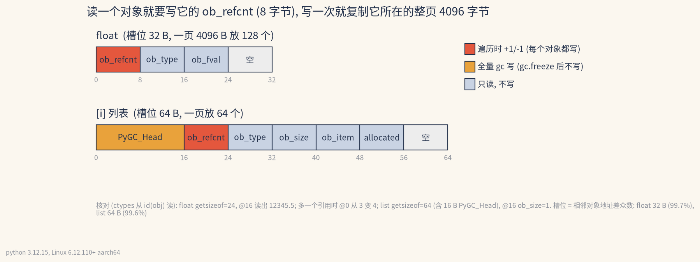
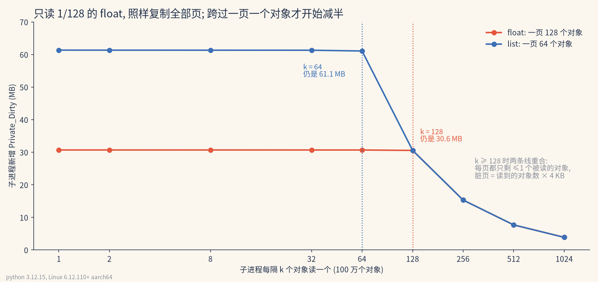
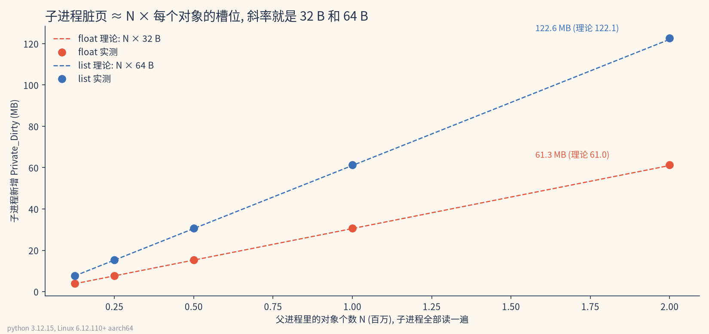

# fork之后子进程只读也会复制内存

父进程备好 100 万个 float 再 fork, 子进程只把它们读一遍. 子进程自己的脏页多了 31432 KB, 一个值都没改.

## 0x00 读一个对象, 写它的 8 个字节



上图证明"读"落在哪几个字节上. 红格是 `ob_refcnt`: float 槽位的第 0 到 8 字节, 列表槽位的第 16 到 24 字节. 遍历每取一个元素, 这 8 字节先加一再减一. 列表前面那 16 字节 `PyGC_Head` 是全量 gc 写的, float 不归 gc 管, 没有这一格.

```python [b3-核对偏移]
f = 12345.5
ctypes.c_double.from_address(id(f) + 16).value   # 12345.5, 偏移 16 是 ob_fval
ctypes.c_ssize_t.from_address(id(f)).value       # 3, 再多一个引用变 4: 偏移 0 就是 ob_refcnt
```

槽位大小不是猜的: 相邻两个对象的地址差, 99.7% 是 32 B (float), 99.6% 是 64 B (列表). 所以一页 4096 B 放 128 个 float, 或者 64 个列表.

## 0x01 按页复制, 读得再稀也逃不掉



上图证明复制的单位是页, 不是对象. float 每 128 个只读 1 个, 子进程仍弄脏 31292 KB. 全读是 31432 KB, 只差 140 KB. k 到 256 时每两页才读一个对象, 降到 15672 KB. 列表的拐点在 k=64, 正好是一页放 64 个. 过了拐点两条线重合, 脏页就是读到的对象数乘 4 KB.

## 0x02 脏页能提前算



上图证明脏页约等于 N 乘槽位. 2M 个 float 实测 62808 KB, N × 32 B 是 62500 KB. 2M 个列表实测 125560 KB, N × 64 B 是 125000 KB. 两边都只多出 0.5% 左右. 上线前拿 `sys.getsizeof` 和对象个数, 就能估出每个 worker 多吃多少内存.

## 0x03 gc.freeze 只挡 gc

| 子进程做了什么 (100 万个列表) | 没有 freeze | 先 gc.freeze() |
|---|---|---|
| gc.collect() | 62.0 MB | 0.1 MB |
| 遍历一遍再 gc.collect() | (没测) | 61.3 MB |

Python 文档的办法: 父进程早点 `gc.disable()`, fork 前 `gc.freeze()`, 子进程里 `gc.enable()`. 它让 gc 不再碰橙格, 第一行从 62.0 MB 压到 0.1 MB. 红格它管不着, 子进程一遍历又回到 61.3 MB. 子进程要逐个读的大数据, 该放进 `array` 或 `mmap` 这类不带引用计数的连续内存. 这一条本文没测.

三张图的数字来自 [b3_data.json](b3_data.json), 是 [measure_b3.py](measure_b3.py) 的第二次运行. 图由 [make_b3.py](make_b3.py) 画. 表里的数字来自 [measure.txt](measure.txt) (由 [fork_cow.py](fork_cow.py) 生成). 环境是 Linux 6.12 aarch64 加 Python 3.12.15.
