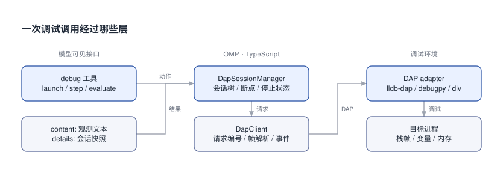

# oh-my-pi 为什么好用: 把 LSP, 调试和编辑改成 Agent 能用的形状

<Lead
why="Agent 基本都能调 LSP, 用起来差距却很大. 差在哪, 看功能列表看不出来"claim="LSP 是给坐在 IDE 前的人设计的. OMP 好用, 是把 Agent 打破的几个前提一个个补上了"use="自己写 agent loop 时知道先做哪条: 写完文件当场拿到这次改动的诊断"/>

来源是 oh-my-pi (下称 OMP) 18.8.7 的源码和文档, 提交 [`d485860`](https://github.com/can1357/oh-my-pi/blob/d485860ba15c3fce2b0e2c1a02c0d88c8f53c448/README.md). 文中的毫秒数都出自这个提交, 以后可能会变

## 服务器回答的是内存副本, 不是磁盘

先把 LSP 的工作方式摆清楚, 后面每一节都从这里推出来

语言服务器 (tsserver, rust-analyzer, clangd) 不会自己去读磁盘. 客户端用 `didOpen` 把文件内容交给它, 改一个字就发一次 `didChange`. 它的类型推导, 跳转, 报错, <Red>全都基于这份内存副本</Red>

<Figure src={require('./fig-copy.svg').default} alt="编辑器和 OMP 改文件会通知服务器, bash 改文件不会" caption="IDE 里只有编辑器一个写入者, 副本永远是对的. Agent 多了 bash, sed 这条路, 副本和磁盘就会悄悄分叉" />

IDE 的设计还藏着第二个前提: 人能等. 红线晚一秒出来没关系, 人会看着它出来. Agent 不会等, 工具一返回, 它就拿着结果往下走

所以给 Agent 接 LSP, 难的不是调用, 是这两个前提坏掉之后怎么办. 下面四节是 OMP 的答案

## 查询前先把副本和磁盘对齐

一个很常见的场景: 模型想批量改名, 直接用了 `sed`

```bash
sed -i 's/getUser/fetchUser/g' src/api.ts src/page.ts
```

接着它调 `lsp references` 查 `fetchUser` 还有哪里在用. 服务器的副本里根本没有这个名字, 返回空. 模型会得出 "没人用了, 可以删" 的结论, 这比报错更糟

OMP 在每次语义查询之前调 `reconcileFileFromDisk()`: 没打开过的文件先 `didOpen`, 磁盘内容变了就发 `didChange`, 并丢掉这个文件缓存的旧诊断. 这样查询拿到的一定是磁盘上的现状

有一个例外要小心. OMP 自己正在写的文件, 新内容已经同步给服务器, 磁盘上却还是旧的. 这时去对齐, 会把服务器回退成旧版本. 所以写入期间挂一个 pending 标记, 对齐跳过它

## 写完当场拿到这次改动引入的错

还是先看朴素做法: 写完文件, 马上再调一次 `diagnostics`

问题是诊断是服务器算完后异步推回来的. 刚写完就去拿, 拿到的多半是改之前那一份. 比如模型把 `user.name.toUpperCase()` 写进了一个 `name` 可能为空的地方, 旧诊断是干净的, 模型就以为没问题

OMP 的 `edit` 和 `write` 落盘都走 [writethrough](https://github.com/can1357/oh-my-pi/blob/d485860ba15c3fce2b0e2c1a02c0d88c8f53c448/packages/coding-agent/src/lsp/writethrough.ts), 关键是第一步先记下版本号

<Figure src={require('./fig-writethrough.svg').default} alt="OMP 记下诊断版本, 同步内容, 写盘, 只采用比基线新的诊断" caption="旧的 v7 诊断就算晚到, 也不会被当成这次改动的结果" />

服务器推诊断时不一定带版本号. 不带的, OMP 等推送安静 250 ms 再算数. 服务器支持 pull 的, 就主动发 `textDocument/diagnostic` 去拉

结果是模型改完这一处, 工具返回里就带着 "possibly undefined" 这条错. <Gold>不用另起一轮去查, 改错在同一轮就被看见</Gold>. 这一条是 OMP 和 "带了个 lsp 工具" 的 Agent 拉开差距的地方

## 慢服务器不拖住编辑

上一节有个隐患: 要是每次写入都把诊断等到底, rust-analyzer 第一次索引大项目要几十秒, 整个 Agent 就卡在那里

OMP 把 "写文件" 和 "等诊断" 拆成两件事. 文件一定先落盘. 诊断只在结果里等 500 ms

<Figure src={require('./fig-deadline.svg').default} alt="0 到 500 ms 进结果, 500 ms 到 12 s 后台补发, 之后看不到" caption="快的服务器当场看到, 慢的下一轮看到, 谁也不拖谁" />

后台补发要调用方有通道把消息塞回会话. CI 这类没有后台通道的调用方, 才会阻塞着等

同样的思路也用在服务器进程上. 服务器默认懒启动, 第一次用到才拉起. 初始化失败的, 3 分钟内不再重试, 免得每次查询都重新失败一遍

## 列号由 OMP 自己找, 模型只给名字

LSP 里的位置是行加列. 人用鼠标点, 列号永远准. 模型要自己数, 常常差一两个字符

<Figure src={require('./fig-column.svg').default} alt="模型数错列号落到 user 上, OMP 按符号名找到 getUser" caption="列号偏了不会报错, 只会安静地查到隔壁的符号" />

OMP 的 `lsp` 工具只让模型给行号和符号名, 列由 `resolveSymbolColumn()` 在这一行里按单词边界找. 同一行出现两次, 用 `getUser#2` 指第二个

给了行却不给名字, `definition`, `references`, `rename` 直接报错, 不去猜 "这行第一个词". <Red>宁可让模型重来, 也不给它一个可能错的答案</Red>

## 整个项目能不能编过, 问编译器

推送诊断只覆盖打开过的文件. 模型问 "整个项目现在有没有错", 问 LSP 是问错了人, 没打开的文件它根本没算过

<Compare caption="同一个问题, 两种答法" left={{
title: "问 LSP", items: ["只看打开过的文件", "没打开的文件里的错看不到", "看起来全绿, 其实没检查"], }} right={{title: "OMP: file 传 *", items: ["直接跑 cargo check, tsc --noEmit", "或 pyright, go build", "编译器把整个项目都过一遍"], }} />

## 断点把 "可能越界" 变成 "i 等于 3"

静态审查最多说到 "`values[i]` 可能越界". C 的未定义行为不保证崩溃, 跑一遍没出事, 什么也证明不了

```c
int main(void) {
  int values[3] = {10, 20, 30};
  int i = 3;
  return values[i];   // 第 4 行, 越界
}
```

OMP 的 `debug` 工具用 DAP 协议驱动 `lldb-dap`, `debugpy` 这类调试器. 在第 4 行断住, 读出 `i=3`, `values` 是 `int[3]`, 猜测就成了证据



自己实现时最容易踩的坑在启动握手. 有些调试器要先收到 `configurationDone` 才回 `launch` 的响应. 先 await `launch` 再设断点, 两边会互相等死. 正确顺序放在最后一节

## 补丁绑在模型看到的那个版本上

按行号改文件有个老问题: 模型读完之后文件又被改过, 行号整体错位, 补丁被安静地打到别的行上

<Compare caption="补丁里多带一个版本号" left={{
title: "朴素做法: 按行号改", items: ["只说 \"改第 40 行\"", "文件变过就改错地方", "工具照样报成功"], }} right={{title: "OMP: hashline", items: ["read 结果带 4 位十六进制快照 TAG", "edit 每段写 [path#TAG], 行号相对这个快照", "版本对不上, 编辑不会被当成对的"], }} />

整块替换按 tree-sitter 节点来, 模型说 "替换这个函数" 就行, 不用数函数在哪一行结束

## 会改状态的工具单独跑

Agent 一轮会并行调很多工具, 读文件和查 LSP 并行没问题. 但有些工具会改变别的工具看到的世界

调试器的 `step_over` 走一步就换掉当前栈帧. 这时并行去读 `variables`, 读到的可能是另一帧的值, 模型却当成同一时刻的证据

<Flow caption="debug, edit, write 被标成独占" steps={[
{ name: "前面的共享工具全部跑完", tone: "ok" }, { name: "独占工具单独执行", tone: "good" }, { name: "后面的共享工具再开始", tone: "ok" }, ]} />

## 放到我的项目里

- **自己的 agent loop 先做写完即诊断**: 版本基线, 500 ms 内联, 后台补发. 收益最大, 模型在同一轮就知道自己写坏了什么. 查询前对齐磁盘是它能成立的前提, 一起做
- **LSP 工具的参数用行号加符号名**: 不让模型给列号
- **HX-AI-Review**: LSP 诊断和断点读到的值都是确定性证据, AI 的 Warning 带着它们才有资格升级. 见 [HX-AI-Review 通用 AI CR 方案](../../005-代码审查/003-HX-AI-Review通用AI-CR方案/index.md "hxid:hx-10e4a03c")

## 什么时候不成立

<Boundary items={[
"项目里没有语言服务器, 或找不到 Cargo.toml 这类项目根标记: 整套 LSP 不启动, 写入也不带诊断", "服务器超过 12 s 才出诊断: 这一轮模型看不到. 大型 C++ 或 Rust 项目首次索引常常这样", "没有可复现的调试构建: 断点验证做不了, 只能停在静态猜测", "并发和时序问题: 断点本身改变时序, 观察到的不代表线上", "evaluate 能执行有副作用的表达式. 超时后 OMP 只是不再等, 不发取消, 不能当成没执行去重试", ]} />

## 留着查

DAP 启动握手, 出自 [session.ts](https://github.com/can1357/oh-my-pi/blob/d485860ba15c3fce2b0e2c1a02c0d88c8f53c448/packages/coding-agent/src/dap/session.ts). 要提前监听 `stopped`, 防止事件先于 await 到达

```text
initialize → capabilities
发送 launch, 保留 Promise, 先不 await
等待 initialized 事件
设置断点 → 按能力发送 configurationDone
等待 launch 响应
等待 stopped 事件 → 读取 stack/scopes/variables
```

完整行为见 [docs/tools/lsp.md](https://github.com/can1357/oh-my-pi/blob/d485860ba15c3fce2b0e2c1a02c0d88c8f53c448/docs/tools/lsp.md), 入口在 [lsp/tool.ts](https://github.com/can1357/oh-my-pi/blob/d485860ba15c3fce2b0e2c1a02c0d88c8f53c448/packages/coding-agent/src/lsp/tool.ts)

同目录有两个能跑的复现

- [dap-demo.py](dap-demo.py): Python 标准库直接驱动 `lldb-dap`, 编译上面这段 C, 在第 4 行断住读变量. 在 Linux, Python 3.14, clang/LLDB 23.1.1 上跑过, 没有跑完整 OMP CLI
- [barrier-demo.mjs](barrier-demo.mjs): 只复现共享和独占的调度规则, `node barrier-demo.mjs` 断言 A, B 并行, 然后 step, 最后 C
