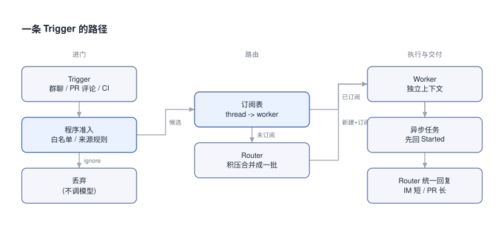

# DeepSeek Harness Super-agent设计探索: 双层架构与事件驱动

原文给了一个数: 一个人通常只跟得住 3 到 5 个活跃 Session. 我整理它, 是想看清这个上限怎么从人身上挪回系统里.

## 0x00 注意力的上限

现在的 Agent 以一个 Session 为单位, Session 之间互不知道. 同时推进三件事, 就得开三个窗口, 自己记住每个窗口在干嘛.

DeepSeek Harness 团队在[《Super-agent 设计探索》](https://www.bilibili.com/opus/1265361021143351318)里把这件事说成: 单任务的上限看模型, 多任务的上限看人的注意力. 给单会话 Agent 加 CLI, MCP 或连接器都绕不开它: 会话还是同步阻塞, 任务一多上下文就混, 本机一离线就停.

他们要的东西叫 Super-agent, 用四个特征定义: 连续 (在 IM 定了方案 A, 转头在 PR 评论里改成 B, 它跟得上), 高效 (不等上一件做完就接下一件), 主动 (自己盯着环境事件, 推进值得处理的事, 不该出声时安静), 持久 (常驻在线, 出错自愈).

一个 ReAct Loop 满足不了这四条, 所以原文拆了五个模块, 每个模块借一条计算机系统里的老思想:

```text [对照-模块与特征]
双层架构        -> 连续 + 高效    借: 序点, 分层调度
事件驱动        -> 主动          借: Fast Path / Slow Path, Cache 与局部性, 投机执行
面向人的交互    -> 连续 + 高效    借: 全双工
计算/状态/环境分离 -> 持久        借: 存算分离
Watchdog        -> 持久          借: 外部 Control Loop
```

> [!NOTE]
> 原文开头就声明: 这是架构思路探讨, 不是 DeepSeek Harness 现有产品功能的介绍. 文末提到的实现插件名在 B 站接口返回里是空的 [不确定], 原文称它是验证路线的原型.

## 0x01 跟着一条 Trigger 走

驱动 Super-agent 的是环境里冒出来的半结构化事件, 原文叫 Trigger: 群聊消息, 邮件与日程提醒, PR 评审评论, CI 结果. 原文把它和人逐条键入的提示词对立起来讲.

下面整篇都跟着一条 Trigger 走. 它从左边进门, 先过程序准入, 再看所在的 Thread 有没有人订阅, 最后由 Worker 执行, 由 Router 统一回话:



上图左列管"要不要理它", 中列管"交给谁", 右列管"怎么做, 怎么回". 五个模块里有三个就排在这条路上, 存算分离和 Watchdog 管的是这条路能不能一直开着.

我把这条路写成了一个只用标准库的侧车 [super_agent_sidecar.py](./super_agent_sidecar.py), LLM 用确定性函数代替, `python3 super_agent_sidecar.py` 直接跑. 核心是这段分发:

```python [侧车-分发]
async def dispatcher(router, workers, stats):
    while True:
        t = await DISPATCH_Q.get()
        if not admit(t):                 # 程序层准入, 不调模型
            stats["dropped"] += 1
            continue
        subs = SUBSCRIPTIONS.get(t.thread_id)
        if subs:                         # 已订阅: 直通 Worker
            stats["direct"] += 1
            for wid in subs:
                await workers[wid].handle(t)
        else:                            # 未订阅: 进 Router 收件箱
            stats["to_router"] += 1
            await router.inbox.put(t)
```

```text [侧车-运行输出]
== 突发: 5 条同时到达
  [worker-1] m1: 登录页按钮错位, 谁能修一下
  [worker-2] m3: PR #7 review: 缓存层加个 TTL
  [worker-3] m5: CI 失败: test_auth 超时
  [router] 第 1 次调用, batch=4
== 后续: 同一 Thread 的跟进
  [worker-1] m6: 顺便把 hover 颜色也改了
  [worker-2] m7: 发起 task-1 -> Started, 不阻塞
  [worker-2] task-1-done: task-1 完成: 12 passed
== 统计
  丢弃 1, 直通 3, 进 Router 4
  Router 调用 1 次, 做了 4 个决定
```

字段名是我自拟的, 原文只给语义. 下面几节按这段输出的顺序讲.

## 0x02 进门: 两级过滤

接进真实群聊和代码平台以后, 事件流是"高噪音, 低触发率"的: 大部分消息跟 Agent 无关. 所以先由程序挡一道, 再让模型挡一道.

程序层按来源, 群组范围, 用户或机器人白名单做确定性准入. 每个来源可以设成三种之一: 仅响应明确请求, 作为候选事件, 直接忽略. 侧车里的 `ADMISSION` 就是这张规则, 机器人发的站会提醒在这里被丢掉, 一次模型都没调.

通过准入的候选事件才交给 LLM, 按提示词里写的策略判断要不要行动. 这一层顺便是个扩展点: 想加一条策略, 用自然语言写进提示词就行.

> [!TIP]
> 下面是我对照 3.1 与 3.2 两节的归纳, 原文没有合并着说. 白名单和下一节的订阅表是同一个做法: 模型只做第一次判断, 判断结果写成程序状态, 之后由代码执行. 系统能绕开模型的比例, 看有多少判断已经被写成了状态. 反过来, 下面 0x06 的 Inline & Spill 不属于这条规则: 它决定喂多少信息, 不决定绕不绕过模型.

## 0x03 已订阅的 Thread 直通

Thread 是同一个 PR, 同一个 IM 话题, 或同一串往来邮件下的连续事件. Router 看到一个新 Thread 的第一条事件, 建一个 Worker, 让它订阅这个 Thread.

之后同一 Thread 的事件由程序直接送到那个 Worker, Router 不再调工具转发. 侧车输出里 `m6` 和 `m7` 就是这样走的: 没进 Router, 直接到了 worker-1 和 worker-2.

订阅是多对多的. 事件超出任务范围时, Worker 可以退订或交回 Router; 没被订阅的新事件才轮到 Router 判断. Router 仍然看得到所有事件, 只是不再替已订阅的 Thread 做决定.

直通省了什么, 原文 7.1 节做了消融: 去掉直通以后, 完成时间基本不变, Router 的决定数多了约 30%, 总读缓存 token 从 2323 万涨到 3177 万 (约 37%). 实验是合成负载, 单次约 300 条消息里约 20 条工作请求, 每种方案重复 5 次.

所以在这组负载下, 直通不提高完成质量和速度 (完成时间基本不变), 只省了 Router 的 token 和推理开销. 去掉它 Router 峰值负载变高, 但还没碰到单个 Router 的吞吐瓶颈.

## 0x04 Router: 序点与批处理

先看两个极端. 所有事件塞进一个 Session: 上下文最连续, 但一个 ReAct Loop 是串行的, 吞吐低, 几件事的细节搅在一起. 每条事件新开一个 Session: 吞吐最高, 但每个都没有全局上下文, 而且会各自跑去回复用户.

双层架构取中间: 常驻的 Router 层承接所有入口的人类交互和全局协调, Worker 层并发干活. "双层"指逻辑职责, 每层内部可以再有结构.

Router 是全局序点, 协调点和记忆. 它只做交互和分派, 不亲自执行, 原文说它甚至可以不配 Bash. 它也不是 Agent Team 里的 Team Lead: Team Lead 要深入拆一个复杂任务, 推理很重; Router 只管任务之间的关联, 任务常常不复杂, 较轻量的模型能兼顾速度和效果.

突发事件靠批处理扛. Router 推理期间到达的 Trigger 先排队, 下一轮合并进一次 LLM 调用. 侧车里突发 5 条, 丢掉 1 条后剩下 4 条在一次调用里分派完, 就是 `batch=4`.

原文 7.2 节压测了这件事 (Router 调真实模型, Worker 用 Mock): Trigger 到达速率从约 1 条/分钟升到约 40 条/分钟, 平均 batch 从 1.0 升到 2.8, 单次请求从 2.5 秒变成 3.9 秒, 摊到每个决定上的推理时间从 6.4 秒降到 1.6 秒.

> [!TIP]
> 批处理摊薄的是 Prefill, 也就是输入侧的并行计算; 输出 token 的解码还是按长度串行. 所以这招成立的前提是 Router 每一步"长输入, 短输出". 不配 Bash, 不亲自执行, 都在保这个前提. 我是从 2.1 节两句话反推的, 7.2 节的 2.5 -> 3.9 秒正好对得上.

规模再大, Router 可以内部多层过滤, 或者水平切成多个会话. 切得越细, 并发越高, 分片之间的记忆越断. 这条权衡在全局记忆解决之前一直存在; 按原文的说法, 以他们团队现在的规模, 单个 Router 加直通加链式召回已经够用.

## 0x05 Worker 与异步工具

Worker 在独立上下文里专注一件事, 挂完整的执行工具, 配最强的模型. Worker Session 直接决定任务结果和代码质量. 它的推理和工具调用不往外部信道吐, 只向 Router 汇报.

Worker 之间一般不直接通信. 冲突多半出现在同一个 PR 这种共享环境里, 而订阅同一 Thread 的 Worker 会收到相同事件, 有机会自己发现并解决冲突; 少数跨任务协同由 Router 中转. Worker 内部再开 Subagent 或者本身就是一个 Agent Team, Router 都不用知道.

分工交给结构还是交给提示词, 7.1 节有对照. 同样是约 300 条消息, 约 20 条工作请求, 重复 5 次:

```text [消融-完成时间]
Super-agent (双层架构)            p50 12.4 分钟   p95 15.7 分钟
单 Session + Subagent, 中性提示     5 次里 0 次委派, 全在主 Session 里做并被新消息打断, p95 29.5 分钟
单 Session + Subagent, 优先委派提示  5 次里 4 次委派, 变快但仍慢于 Super-agent; 剩下 1 次模型觉得活"很小"自己做了, 拖出长尾
```

中性提示原文是 "Use a subagent for a piece of work when appropriate...". 双层架构让"分不分工"由结构决定, 不看模型临场怎么想. 代价是多个独立会话, 单次实验的读缓存 token 比单 Session 高.

会话本身也要能边干边听. 经典 ReAct Loop 发起一次同步 `run()` 就阻塞到工具返回, 中间来了新消息也没法理. 原文 4.1 节的异步版本是: 耗时命令或子任务一发起就立即返回"已启动 (Started)", 循环不等; 后台做完, 结果作为一条新事件投回会话; 跑太久的后台命令, 模型可以按上下文主动终止.

侧车里 `m7` 发起 `task-1` 后立刻返回 Started, 做完以后 `task-1-done` 以 `source="task"` 的 Trigger 回到分发队列, 又因为 `pr-7` 已被订阅而直通回 worker-2. 新输入在当前推理步结束后就能处理, 这就是原文说的全双工.

> [!NOTE]
> 原文 4.1 节用行内代码写了几个异步工具的名字, B 站接口返回里这些位置是空的, 真实名称 [不确定]. 原文说该机制已经在 DeepSeek Harness 里实现, 截至发文时还没默认开启.

## 0x06 上下文按 Cache 管

每条 Trigger 进上下文时, 都要决定带多少东西. 放多了挤窗口, 稀释注意力; 放少了模型得反复调工具去读, 步数变多.

原文把窗口当 Cache 管, 叫 Inline & Spill: 近期会用的信息 Inline 进来, 超预算或低频的 Spill 出去, 窗内只留引用或摘要. Inline 按局部性分三步: 先放当前对象的 ID 和摘要; 再内联紧密关联对象的 ID; 再附时空相邻的内容, 比如内容前 50 字, IM 消息前后的相邻消息和被回复的那条, 评审评论所在讨论里的相邻评论. 长内容设小上限, 超出部分截断并留续读入口.

侧车 `Trigger.summary` 只取前 50 字, `ref_ids` 放关联 ID, 就是这一层的最小版.

链式召回是在它上面再走一步: Trigger, Thread, Worker Session 都有唯一 ID, 注入时互相内联, 召回结果自己也按 Inline & Spill 带着下一跳的摘要和 ID. 模型于是能顺着引用逐跳展开, 例如 当前消息 -> 所在 Thread -> 相关 Worker Session -> 该 Worker 关联的另一个评审 Thread. 它主要覆盖近期任务, 缓解 Router 长跑以后忘事.

> [!TIP]
> 3.3 节没写这一点, 但按它的定义, 链式召回每一跳都沿内联的 ID 走, 所以当前事件里至少得有一个关联 ID. 在 IM 里只说"上周那个方案", 不贴 PR 链接, 当前事件和旧任务之间就没有边可走. 吃亏的是跨信道, 不带链接去追问几周前任务的人.

## 0x07 投机执行与按信道回话

主动的另一半是投机执行: 根据环境信号先在后台试, 有价值才交付, 没价值就丢掉, 一声不吭.

原文举了两个例子. 收到会议邀约时, 先核对日程冲突, 搜背景, 备好回复草稿, 等用户过目再发. DeepSeek Harness 内部用户群配了"静默复现并修复": 有人反馈问题, Agent 先在后台复现找修复, 确认是问题且找到简单修复才出声, 否则全程安静.

回话这一步由 Router 统一出口, 按信道带宽定规矩. IM 这类即时信道只在要决策或验收时打扰人, 只问直接问题, 给短结论; 他们验证过的硬规定是单次回复不超过 100 词. GitHub, 邮件, 文档这类异步信道反过来, 按项目规范写全背景, 改动说明和验证结果.

这条做得到, 靠的是双层架构已经把冗长推理和密集工具调用关在 Worker 里.

## 0x08 常驻不倒: 存算分离与 Watchdog

前面整条路要一直开着. 本地 Agent 默认把计算, 会话状态, 执行环境绑在同一台机器上, 机器一休眠 Agent 就停.

第一步把 Agent Loop 的计算放进云端无状态容器, Session 这些持久状态放进数据库. 容器可以水平扩, 重启, 替换, 连续性由存储保证.

第二步是执行环境. 在云端沙箱里重建一份真实环境很难: 未提交的修改, 私有凭据, 内网依赖, 特定硬件和工具链都要同步. 让用户整个搬到云上又太贵. 原文的做法是让环境留在原地, 端侧只跑一个轻量 daemon: 不存会话状态, 只执行命令, 返回结果.

```text [分离-谁放哪]
计算 (Agent Loop)   -> 云端无状态容器, 可重启可替换
状态 (Session 等)    -> 数据库
执行环境            -> 留在用户机器, 端侧 daemon 只执行命令并返回结果
```

这和 Anthropic 提的"脑手分离" (Decoupling the brain from the hands) 一致: harness 无状态, 会话日志在 harness 外面, 按需接执行环境. 区别在场景: Anthropic 那篇针对托管服务 (按需沙箱, 客户 VPC 内资源), 这里首先接会间歇离线的个人机器. 方案支持 BYOM (Bring Your Own Machine), 也支持云托管机器; 设备重新上线, 云端自动补跑该在它上面执行的任务.

> [!TIP]
> 原文没把这件事和 DSH 现有的 Runtime 对起来, 我对了一下: 这个 daemon 有现成的接入点. [DSH Runtime 那篇讲的能力接缝](hxid:hx-3acd866f): 上层工具只依赖统一的文件服务和子进程服务, 两个 provider 一起换掉, 执行环境就整体迁到远处. 端侧 daemon 相当于一个新 provider, 面向模型的工具不用改.

光分离还不够. 很多 Agent 异常出在模型原地打转或者跑偏, 进程好好活着, 存活探测和监控脚本都看不出来. 所以原文在主系统外面放了一个由定时消息驱动的独立 Agent Session, 叫 Watchdog.

它处理接口报错和状态恢复失败, 也让模型判断每个 Worker 有没有实质进展, 方向有没有偏离总目标; 外部偶发故障就一直复查到恢复. 它自己有完整工具, 维护者可以直接问它故障原因, 或者让它在线改提示词, 调触发规则.

> [!TIP]
> Watchdog 修一个卡死的 Loop, 做法就是扔掉当前计算容器, 从持久状态重建. 计算和状态还在同一台机器上时, 重启计算会把状态一起丢掉, Watchdog 只能告警. 原文第 6 节以"除了第 5 节的存算分离, 还需要"开头, 也是把两者当成持久在线的两个条件 (这层依赖是我推的).

## 0x09 代价与没解决的事

下面按"谁来付"列一遍代价. 原文写了一部分, 剩下几条是我按它的实验条件推的:

```text [代价-谁付]
双层架构   多会话的读缓存 token 更高; 收益在约 300 条消息的并发负载下测得, 日均一两个任务的按量付费用户拿不到对应收益
Worker 隔离 在 IM 里追问实现细节的评审者, 要等 Router 再召回或转问 Worker, 多一跳延迟
订阅直通   在这组实验负载下不提高完成质量和速度, 只省 Router Session 的 token 和推理开销
批处理     只在约 1 到约 40 条/分钟之间测过; Router 输出一变长, 收益就被吃掉
投机执行   被丢弃的尝试照样花钱: 群里一串最后不是 bug 的讨论, 复现的 token 和 CI 费用由配置策略的维护者付
```

第 7 节所有数字都来自合成负载和简化环境, 编码工作被只耗时间的工具代替了, 不能当成真实编码任务的完成时间来用. 原文 13 张配图我没做文字识别, 细节以正文为准.

原文第 8 节自己列了四个没解决的问题:

- 扩展: Router 什么时候切, 切多细; Worker 什么时候直接通信. 针对 Router 的事件判别, 批量分派, 上下文召回做专项训练, 是系统和模型协同设计的方向; 跨月的长程记忆是主要瓶颈.
- 协作: 以聊天窗口为中心被看作路径依赖, 交互可以放进 Issue, PR 这类领域界面; 中途介入, 接管, 实时协同怎么做还没定.
- 边界: 组织怎么配 Super-agent, 等于怎么划上下文的共享与隔离; 隔离的实例之间要协同, 就是 A2A (不特指某个协议).
- 安全: 事件驱动把不可信输入面放大了; 云端 Loop 一旦被入侵或被提示词注入攻破, 连着的所有端侧设备都有被控风险; 凭据进上下文就可能泄露, 得让 Agent 用凭据但碰不到凭据本身.

我接下来想在侧车里加个计数: 跑满一天, 看有多少比例的 Trigger 根本没进模型.
